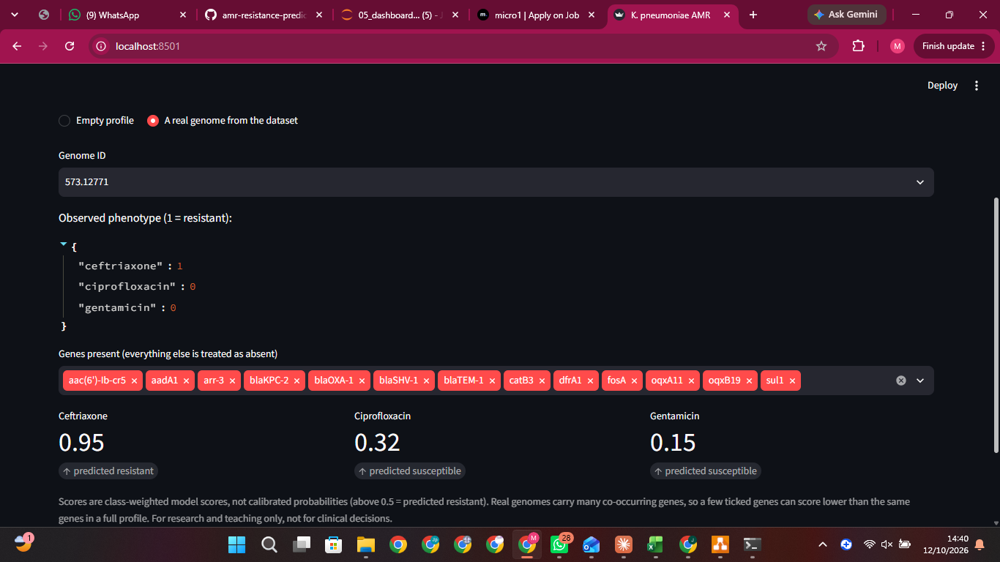

# Predicting Antibiotic Resistance in *Klebsiella pneumoniae* from Genomic Data

Machine learning models that predict resistance to **ceftriaxone, ciprofloxacin and
gentamicin** from the antimicrobial resistance (AMR) genes found in bacterial genomes,
plus an interactive Streamlit dashboard.

## Data
- 2,440 *K. pneumoniae* genomes with lab-measured phenotypes (Resistant/Susceptible)
  for all three drugs, from BV-BRC.
- Genes annotated with AMRFinderPlus 4.2.7 (database 2026-08-07.1), `--organism
  Klebsiella_pneumoniae --plus`.
- After genome-size QC: **2,411 genomes**, 543 AMR genes/mutations; 102 genes kept after
  removing those present in under 1% of genomes (or over 99%).

## Notebooks (run in order)
| Notebook | What it does |
|---|---|
| `01_data_download_and_annotation` | Data source decision, genome selection, download and annotation record, class balance |
| `02_amr_gene_matrix` | Builds the gene presence/absence matrix; removes 29 genomes outside 4.5-6.5 MB |
| `03_exploratory_analysis` | Prevalence, gene filtering, Fisher-test associations, PCA |
| `04_modelling` | Baseline vs logistic regression, random forest, gradient boosting; lineage-aware validation |
| `05_dashboard_prep` | Final models and tables for the dashboard |

## Key results
5-fold cross-validated ROC-AUC (no-skill baseline = 0.50):

| Drug | Random folds | Lineage-aware folds |
|---|---|---|
| Ceftriaxone | 0.99 | 0.98 |
| Ciprofloxacin | 0.99 | 0.98 |
| Gentamicin | 0.98 | 0.96 |

- The three model types performed almost identically; logistic regression is used in the
  dashboard because it is easy to interpret.
- The largest model weights match known mechanisms: *bla*CTX-M and *bla*KPC for
  ceftriaxone, *gyrA*/*parC* mutations and *qnr* genes for ciprofloxacin, and
  *aac(3)*, *ant(2'')*, *armA*, *rmtF1* for gentamicin.

## Dashboard
```bash
streamlit run dashboard/app.py
```
Tabs: overview (prevalence and model performance), gene explorer, and a prediction tool
where you tick genes or load a real genome from the dataset.

## Reproducing
```bash
conda create -n amr -c conda-forge -c bioconda python=3.11 ncbi-amrfinderplus
conda activate amr
pip install -r requirements.txt
```
Genomes and AMRFinderPlus outputs are not stored in the repo (see `scripts/` for how
they were downloaded and annotated).

## Limitations
- Features are known resistance genes, so the models cannot discover new mechanisms.
- The dataset is enriched for clinical isolates, so prevalence is not representative of
  the general population.
- Lineage-aware validation groups genomes by gene-profile similarity, not by
  core-genome phylogeny.
- Dashboard scores are class-weighted model scores, not calibrated probabilities.
- No independent external test set. For research and teaching only, not clinical use.
